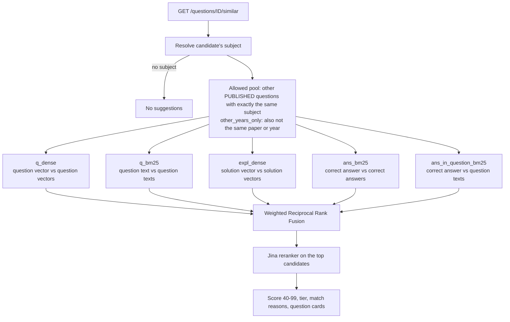

# Similar Questions — How It Works

When a student looks at a previous-year question (PYQ), the platform suggests other questions that test
the same idea or fact. This document explains how those suggestions are produced, which code is
responsible, how to run and operate it, why it is built the way it is, and what is left to do.

**Reading order for the next developer (or an AI assistant):**
1. [§0](#0-current-status-handover-2026-11-22): what is done, what is not, and the state of each database.
2. [§10](#10-merging-this-work-into-another-copy-of-the-codebase): how to bring this work into another
   copy of the code without conflicts: every file, every database change, every setting, in order.
3. [§8](#8-open-items-for-the-next-developer): open items, known issues and potential bugs.
4. §1–§7 explain how the feature works; read them before changing the algorithm.

> **Changes in this copy (2026-11-22), details in [SIMILAR_QUESTIONS_MERGE_LOG.md](SIMILAR_QUESTIONS_MERGE_LOG.md):**
> - **The Jina reranker is optional and off by default.** Without it, the order and the score come from the
>   fused ranking: `score = round(40 + 59 × rrf ÷ max_rrf)` (40–99), `max_rrf` = 1st in every channel that ran.
>   Live searches follow `SIMILARITY_LIVE_USE_RERANKER` (default `false`).
> - **Vectors and similar lists are separate runs.** `backfill_question_embeddings` builds vectors only;
>   `build_similar_lists [--reranker]` builds the lists. Admin → Similar Questions → Search index has two
>   steps with a ranking choice. A PDF upload starts a vectors run only.
> - The algorithm version includes the ranking, and students are served lists built with either ranking.
> - Students see **15** similar questions (admin setting).
> Where §3.4, §3.6 and §6 below say "Jina reranker", read "optional Jina reranker".

---

## 0. Current status (handover, 2026-11-22)

**Backend: done, verified, frozen.** The search follows every rule it promises, with no errors. Verified
on a copy of the real data (`21NovBackup`: 2,190 questions, 1,882 published, 19 papers from UPSC, MPSC,
UPPCS, EPFO and CAPF) with `app/scripts/audit_similar_questions.py`:

| Check (2,190 questions × 3 scenarios = 6,570 requests) | Result |
|---|---|
| Errors (non-200 responses) | 0 |
| A suggestion from a different subject | 0 |
| A suggestion that is unpublished, the question itself, or a duplicate | 0 |
| Number of suggestions = admin setting (6), or fewer only when the subject has fewer other questions | always |
| A question from `exclude_ids` (the student's session) returned | 0 |
| "Other years" returning the same paper or year | 0 |
| Fallback paths used (instead of the main search) | 0 |
| Response time without the reranker | p50 ≈ 46 ms, p95 ≈ 75 ms |
| BM25 scores vs an independent Python implementation | identical |
| Cross-exam: suggestions from another exam family (e.g. an MPSC question for a UPSC one) | 26% of all suggestions; 935 questions get at least one |

The admin setting was also tested end to end in the browser: changing Admin → Similar Questions from
6 to 3 made the endpoint return 3, and back.

**What is left is UI and data work**, listed with file paths in [§8](#8-open-items-for-the-next-developer).
The most visible one: the practice panel's exam toggles hide every cross-exam suggestion by default.
Backend *quality* items (relevance on format-heavy questions, reranker latency, no caching) are listed
there too; they are improvements, not bugs, and need a product decision before anyone changes the backend.

**Decisions already taken (please don't re-open without the product owner):** exact subject names only
(no synonym groups), main subject only, published questions only, no "more from your focus area"
fill-ins, a question without a subject shows no subject and gets no suggestions, the count is an admin
setting, session questions are excluded on the server, old-pipeline links were cleaned up (migration 076),
question boilerplate is not stripped.

### 0.1 Precomputed similar lists (built after the freeze, same day)

**Code: done and tested. Full build: partial (stopped on purpose).**

- Each published question's similar list is computed ahead of time by a tracked **search-index run** and
  stored in the database ([§3.6](#36-precomputed-lists-and-the-search-index)). A stored list is answered
  in ~3 ms instead of ~0.6–8 s with the live reranker. Questions without a stored list, or whose list is
  out of date, are searched live exactly as before, so nothing breaks while the build is incomplete.
- Admins see the state before a run (pending work, estimated Gemini/Jina usage, a reminder to check
  credits), start or resume runs, follow progress, and read each run's report or failure reason at
  **Admin → Similar Questions → Search index**. The backfill script does the same from the command line.
- **Verified on `21NovBackup`:** a trial build of two subjects (Physics, Environment & Ecology, 20 lists)
  gave stored lists identical to live search, 20 of 20; the endpoint returned `"source": "index"` for them
  and `"source": "live"` for an unbuilt subject. 25 automated tests cover the feature
  (`tests/test_search_index.py`).
- **Full build status on `21NovBackup`:** 495 of about 3,750 lists stored (runs #1–#6 in
  `search_index_runs`). The build was stopped at the product owner's request, not by an error; starting
  a run again continues from there.
- **Why a full build takes ~4 hours:** the current Jina key allows **2 requests at a time and 100,000
  tokens per minute** (read from Jina's own HTTP 429 messages). One list sends ~6k tokens (the question
  plus up to 200 candidates), so the key's ceiling is ~16 lists per minute. Runs pace themselves to
  this (§3.6). To build faster: a higher Jina plan, or fewer reranked candidates
  (`SIMILARITY_RERANK_TOP_N`, a ranking change that needs the product owner's decision).
- The runs on 21NovBackup hit, in order: Jina's token limit (run #2, stopped with `jina_quota`), then
  pacing fixes deployed by stopping and resuming runs #3–#5; their rows record these reasons.

### 0.2 State of the databases used during development

| Database | Migrations | Data written by this work |
|---|---|---|
| `21NovBackup` (local copy of the real data, the `.env` `DATABASE_URL` points here) | up to **077** (head) | 076 link cleanup; embeddings for all questions (2,190 question vectors, 1,990 solution vectors); BM25 statistics; 495 stored lists; 6 rows in `search_index_runs`; `site_settings.similar_questions_limit` = 6 |
| `examplannerbackup` (older local copy, used before 21 Nov) | check with `alembic current`; 073–076 were developed on it | embeddings and BM25 statistics from earlier test runs |
| Production / any other copy | **none of 073–077 applied yet** | nothing |

---

## 1. What the feature does

For any question (the **candidate**), `GET /api/v1/questions/{id}/similar` returns other questions that:

1. are **published**,
2. have **exactly the same subject** as the candidate (see [§4](#4-subject-rule-exact-subject-only)),
3. are not already in the student's session (the page sends those IDs as `exclude_ids`),
4. are ranked by how similar they are in wording, keywords, the fact being tested, and the answer.

**How many** are shown is an admin setting (Admin → **Similar Questions**, default 6, range 1–20),
not a frontend constant. The suggestions panel shows **only** similar questions; there are no
"more from your focus area" fill-ins, and a question without a subject gets none.

It is shown in four places in the web app:

| Where | Component | Request |
|---|---|---|
| Signed-in practice (`/practice-exam`) — right-hand suggestions panel | `StudentPracticeExamPage.tsx` → `useSimilarQuestions` | `/similar?include_question=true&exclude_ids=<session>` |
| Guest practice (`/guest-exam`, reached from the marketing site) — suggestions panel | `GuestExamPage.tsx` → `useSimilarQuestions` | `/similar?include_question=true&exclude_ids=<session>` |
| Post-exam report — "Same theme in other years" under each solved question | `PsychometricReportView.tsx` → `SimilarQuestionsSection.tsx` | `/similar?include_question=true&other_years_only=true` |
| Admin Question Bank and Question Review — "Similar Questions Explorer" | `QuestionSimilarExplorer.tsx` | `/similar?include_question=true&other_years_only=<toggle>` |

---

## 2. Where the data comes from

Question papers are uploaded as PDFs and parsed by the extraction pipeline
(`apps/backend/app/pipeline/`, see its `README.md`). Every question block in a PDF looks like:

```
Q1. [Subject: Art & Culture] [Microtheme: Foreign Travellers] [Nano Theme: Ancient & Medieval Foreign Travellers] [Difficulty: Moderate]
Megasthenes visited the court of
(A) Ashoka (B) Harsha (C) Chandragupta Maurya (D) Vikramaditya
Answer: (C) Chandragupta Maurya
Solution: Megasthenes, the Greek ambassador sent by Seleucus I Nicator, visited ...
◆ Reverse Logic Box — Why the other options are wrong ...
```

What the similarity feature uses, and where it is stored:

| From the PDF | Database | Used by similarity for |
|---|---|---|
| `Subject` | `subjects` table (via the question's subtopic) and `questions.subject_raw` | **subject filter** |
| `Microtheme` | `topics` table and `questions.topic_raw` | not used for filtering |
| `Nano Theme` | `subtopics` table (`questions.subtopic_id`) and `questions.subtopic_raw` | not used for filtering |
| Question text | `question_translations.question_text` (English preferred) | question embedding + BM25 |
| Correct option | `question_options.is_correct` + `option_translations.option_text` | answer BM25 |
| Solution | `question_explanations.detailed_solution` (English) | solution embedding |

A question with no subject shows **no** subject chip (never a placeholder such as "General Studies").

> Naming: the PDF's **Microtheme** is stored as a **Topic**, and the **Nano Theme** as a **Subtopic**.
> The hierarchy is `Subject → Topic → Subtopic`, and each question points to one subtopic.

---

## 3. The algorithm



### 3.1 Representations stored per question (`question_embeddings` table)

| Column | What it holds | Built from |
|---|---|---|
| `question_dense_embedding` | Gemini embedding (`gemini-embedding-001`, 3072 dims, stored as `halfvec`) | question text |
| `explanation_dense_embedding` | Gemini embedding | English solution (`detailed_solution`, first 8,000 chars) |
| `question_tsv` | PostgreSQL `tsvector` ('english' stemming and stop words) | question text |
| `answer_tsv` | PostgreSQL `tsvector` | correct option text |
| `question_hash`, `answer_hash`, `explanation_hash` | SHA-256 of the source texts | change detection, so unchanged texts are never re-embedded |
| `answer_dense_embedding` | **Legacy, no longer written or read** | — |

The correct-option text is deliberately **not embedded**: about half of UPSC answers are codes such as
"1 and 2 only", "Only two" or "Statement-I is correct…", and many real answers are one or two words.
An embedding of those carries no meaning (every "1 and 2 only" looks identical). The **solution**
carries the actual fact, so it is embedded instead.

### 3.2 The five retrieval channels

Each channel returns up to `SIMILARITY_CHANNEL_LIMIT` (50) question IDs **from the allowed pool only**.

| Channel | Query (candidate) | Searched against | Finds | Default weight |
|---|---|---|---|---|
| `q_dense` | question vector | other question vectors | same topic / same way of asking | 0.30 |
| `q_bm25` | question text | other question texts | shared names, terms, places | 0.25 |
| `expl_dense` | solution vector | other solution vectors | the same fact asked differently | 0.25 |
| `ans_bm25` | correct answer | other correct answers | the same answer ("Chandragupta Maurya") | 0.10 |
| `ans_in_question_bm25` | correct answer | other question texts | questions that ask *about* this answer | 0.10 |

- **Code answers are never used as queries.** `is_informative_answer()` drops answers made only of
  option codes (`1 and 2 only`, `Neither 1 nor 2`, `A-1, B-2…`, `Both A and R are true…`); for those
  questions the two answer channels are skipped.
- **Dense search is exact within the subject.** The pool is a `MATERIALIZED` CTE so PostgreSQL scans
  only the allowed questions. (An HNSW index scan would look at ~40 global nearest neighbours and filter
  afterwards, losing most same-subject matches.) A subject has at most a few thousand questions, so this
  stays fast.
- A channel with weight `0`, or without input (e.g. no solution), is skipped.

### 3.3 BM25 in plain PostgreSQL (`services/vector/bm25.py`)

PostgreSQL's built-in `ts_rank_cd` has no inverse document frequency (a word in every question,
like "consider" or "statements", counts as much as "Megasthenes"), and `plainto_tsquery` requires
**every** query word to be present. Instead, real BM25 is computed in SQL from the existing tsvectors:

```
score(D, Q) = Σ over query terms t:  idf(t) · tf · (k1 + 1) / (tf + k1 · (1 − b + b · len(D) / avg_len))
idf(t)      = ln(1 + (N − df + 0.5) / (df + 0.5))          k1 = 1.2, b = 0.75
```

- `tf` and `len(D)` come from `unnest(tsvector)` (lexeme positions).
- `df`, `N` and `avg_len` come from two small tables, **`bm25_term_stats`** and **`bm25_field_stats`**,
  recomputed by `refresh_bm25_stats()` after every vectorization run.
- Candidates are questions sharing **any** query term (an OR `tsquery`, served by the GIN index).
- No database extension is needed, so it works on managed PostgreSQL (e.g. RDS).
- There are **no learned sparse vectors** (no SPLADE / BGE-M3 model). The "sparse" side is PostgreSQL's
  own full-text index: `to_tsvector('english', text)` splits the text into words, drops stop words and
  stems the rest ("statements" → "statement"), and stores each word with its positions. That is an
  inverted index, which is exactly what BM25 needs; the scoring is done in SQL.

### 3.4 Fusion and reranking

1. **Weighted RRF:** each candidate gets `Σ weight / (k + rank)` over the channels it appeared in
   (`k = SIMILARITY_RRF_K = 60`).
2. The best `SIMILARITY_RERANK_TOP_N` (200) go to the **Jina reranker** (`jina-reranker-v3.5`) with
   `"Question: …\nCorrect Answer: …"` for both the candidate and each document.
3. The reranker score is mapped to a display percentage:
   `p = 1 / (1 + e^(−4.5·(score − 0.05)))`, `similarity_score = clamp(round(40 + 58·p), 40, 99)`.
   `tier = "exact"` when the score is ≥ 85, else `"related"`.
4. `match_reasons` lists the channels that found the question (`"Matched via q_dense"`, …).
5. With `include_question=true`, each result carries a ready-to-render question card.

If the Jina API key is missing or the call fails, the fused (RRF) order is kept.

### 3.5 Fallbacks (in `routers/questions.py`)

The hybrid search above runs first. If it raises an error or returns nothing, the endpoint falls back to:

1. **AI knowledge-tag similarity** (Jaccard overlap of `questions.knowledge_tags_ai`), when the
   candidate has AI tags.
2. **Knowledge Layer** (`app/knowledge/similarity.py`): shared entities, concepts, relationships and
   theme names — deterministic, cached for 10 minutes.

Both fallbacks pass through `_filter_by_taxonomy`, which applies the **same exact-subject rule** and
returns nothing for a candidate without a subject.

Before all of this, the endpoint first tries the **precomputed list** (§3.6). The response has
`"source": "index"` (stored list) or `"source": "live"` (hybrid search on the spot).

### 3.6 Precomputed lists and the search index

**Why.** The reranker makes a live request take ~0.6 s typically and up to 7–8 s. A question's similar
list only changes when its subject's content changes, so it is computed ahead of time and stored.

**What is stored** (migration 077):

| Table | Holds |
|---|---|
| `question_similarity_lists` | Per published question and mode (`default`, `other_years`): the top 50 matches `{id, score, raw, reasons}`, the subject key and signature it was computed from, the algorithm version, and `complete` (the list holds the whole subject). |
| `similarity_subject_state` | Per subject: the signature its lists were last fully computed from. |
| `search_index_runs` | Every run: status, trigger (script / admin / PDF upload), who started it, phase, options, the estimate shown before it, live progress, the final summary, and the error code and message if it stopped. |

**When a subject is out of date.** A subject's *signature* is a hash over its published questions
(id, paper, year and the hashes of the embedded texts) plus the *algorithm version* (a hash of the
search settings: weights, BM25, RRF, limits, models). Adding, editing, publishing, unpublishing or
moving a question changes the signature of its subject only; changing a search setting changes the
version and so every subject. Only out-of-date subjects are recomputed.

**A run** (`app/services/vector/search_index.py`, `SearchIndexRunner`) has three phases:
1. **embeddings**: new or changed texts (hash check, Gemini batches of 100);
2. **bm25**: corpus statistics;
3. **similar_lists**: for each out-of-date subject, each published question's two lists (4 in parallel),
   with the reranker in *strict* mode: if Jina fails, the run stops instead of storing an unreranked list.
   **The current Jina key allows 2 requests at a time and 100,000 tokens per minute** (found from its
   429 messages on 21NovBackup). One list sends ~6k tokens (the question plus up to 200 candidates), so the
   key's ceiling is ~16 lists per minute: a full build of ~3,750 lists takes about 4 hours.
   Runs therefore keep **one** Jina request in flight (`JINA_RUN_MAX_CONCURRENT_REQUESTS`, leaving the
   other for students) and pace tokens to `JINA_RERANK_TOKENS_PER_MINUTE` (default 80k, `rate_limiter.py`,
   corrected with the token usage Jina reports). On a token 429 the whole run pauses for a minute and sets
   its pace to 80% of the limit stated in Jina's message; a concurrency 429 (a page view holding the other
   slot) is retried after a second. To build faster: a higher Jina plan (then raise both settings), or
   fewer reranked candidates (`SIMILARITY_RERANK_TOP_N`, a ranking change that rebuilds every list).
   Lists of questions no longer published or moved to another subject are deleted.

**Failures and resume.** Provider errors are turned into a code and a message an admin can act on
(`provider_errors.py`): `jina_no_credits` (HTTP 402), `gemini_quota` / `jina_quota` (429 after retries),
`*_auth` (bad key), `*_no_key`, `*_server`, `*_unreachable`. Those stop the run, which is saved as
`failed` with the phase it stopped in. An error that concerns one question only (e.g. HTTP 400) skips that
list, the run ends as `warning`, and the subject stays out of date so the next run retries it. Every step
is idempotent: a list already stored for the current signature and version is kept, so **starting again
resumes where the previous run stopped and nothing finished is paid for twice** (tested).
One run at a time: starting a second gives 409. A run whose heartbeat is older than
`SEARCH_INDEX_STALE_RUN_MINUTES` (15) is marked `interrupted` (server stopped) and no longer blocks.

**Reading** (`stored_similarities.read_stored`). A stored list is used only if its algorithm version is
current and the question is still in the same subject. Every item is re-checked (still published, still
the same subject), excluded ids are removed, then the first `limit` are returned. If too few are left
and the list is not `complete`, the endpoint searches live. Stored lists can lag behind edits until the
next run: e.g. a newly published question appears in its neighbours' lists after the next run. The
admin page shows how many subjects are out of date.

**Estimates.** Before a run the admin page (and `--dry-run`) shows the pending work and an estimate:
Gemini requests and tokens (characters / 4), Jina calls (one per list) and tokens (documents sent ×
average document length), and time. Gemini and Jina do not expose account balances to this app, so the
page says to check credits on both; a run that runs out stops with `*_no_credits` / `*_quota` and resumes.

**Turning it off.** `SIMILARITY_USE_PRECOMPUTED=false` makes the endpoint always search live.

---

## 4. Subject rule: exact subject only

All subject matching lives in **`app/core/subjects.py`**:

- A question's subject is the subject of **its own subtopic** (what its card shows, and what an admin's
  correction updates); if it has none, the PDF's `subject_raw`.
- Two subjects match only if their names are equal after ignoring **case, spacing and `&` vs `and`**.
  There is no synonym list and no substring matching:
  - `Indian Polity & Governance` = `indian polity and governance` ✔
  - `History` ≠ `Modern History` ≠ `History & Culture` ✘
  - `Science & Tech` ≠ `Science & Technology` ✘
- **Only the question's main subject counts.** `question_hierarchy_links` can link a question to extra
  concepts (e.g. added by an admin); those links are ignored for subject matching.
- **One link per question for extracted papers.** The current pipeline creates exactly one link: the
  question's own Nano Theme, marked primary, which is what the subject/topic chips show. Papers from the
  old AI explanation pipeline (removed 2026-09-03) had one link per AI-guessed concept, often in other
  subjects and with wrong "primary" flags, so chips showed the wrong subject (e.g. an Ecology &
  Environment question shown as Geography). Migration `076` reduced those papers to the same one-link
  shape; the removed links are kept in `question_hierarchy_links_backup_076` (`alembic downgrade`
  restores them).
- A question without any subject gets no suggestions.

The same normalization exists in three places and **must stay identical**:

| Where | Function |
|---|---|
| Python | `normalize_subject()` in `app/core/subjects.py` |
| Raw SQL (similarity service) | `subject_sql_expr()` in `app/core/subjects.py` |
| SQLAlchemy (question lists; also works on SQLite for tests) | `subject_norm_column()` in `app/core/subjects.py` |

The rule is also used by the **question-list subject filter** (`list_questions_filtered` in
`app/repositories/question_repository.py`), which builds practice sessions,
subject-wise tests and the admin bank filter — so a "History" session contains only History questions.

---

## 5. Code map

### Backend (`apps/backend/`)

| File | Responsibility |
|---|---|
| `app/routers/questions.py` → `get_similar_questions` | The `/similar` endpoint: stored list, else hybrid search, other-years filter, fallbacks, response shape |
| `app/services/vector/search_index.py` | Search-index runs: plan and estimate, subject signatures, phases, checkpoint/resume, run lock |
| `app/services/vector/stored_similarities.py` | `read_stored`: serve a precomputed list after re-checking it |
| `app/services/vector/rate_limiter.py` | `TokenRateLimiter`: tokens-per-minute pacing of Jina calls during runs |
| `app/services/vector/provider_errors.py` | Gemini/Jina HTTP failures → error code + admin-readable message |
| `app/routers/search_index.py` | Admin API: `GET /api/v1/admin/search-index/status`, `POST /runs`, `GET /runs`, `GET /runs/{id}` (permission `admin.similar_questions`) |
| `app/db/models/search_index.py`, `alembic/versions/077_precomputed_similar_questions.py` | `question_similarity_lists`, `similarity_subject_state`, `search_index_runs` |
| `app/services/vector/similarity_retrieval_service.py` → `HybridSimilarityService` | Subject pool, five channels, RRF, reranking, scoring, cards; `is_informative_answer()` |
| `app/services/vector/bm25.py` | BM25 search in SQL and `refresh_bm25_stats()` |
| `app/services/vector/gemini_embedder.py` | Gemini client: `embed_text` (single, used live) and `embed_texts_batch` (batch, used by the backfill); retries and back-off on 429 |
| `app/services/vector/jina_reranker.py` | Jina rerank client (falls back to input order on failure; `raise_on_error=True` for runs, with longer retries) |
| `app/core/subjects.py` | Subject normalization and matching (Python, SQL, SQLAlchemy) |
| `app/db/models/question_embedding.py` | `QuestionEmbedding`, `Bm25TermStats`, `Bm25FieldStats` models |
| `app/scripts/backfill_question_embeddings.py` | CLI for a search-index run: embeddings (Gemini batch, 100 texts per request), BM25 statistics, similar lists; `--dry-run` prints the plan and estimate |
| `app/scripts/audit_similar_questions.py` | Backend-only audit of `/similar` over every question (see §9) |
| `app/tasks/vector_tasks.py` | After a PDF upload: a search-index run (Celery if a worker is running, else asyncio); embeddings only if another run is active |
| `app/tasks/exam_tasks.py` | Starts vectorization (and Knowledge Layer enrichment) after a PDF is extracted |
| `app/repositories/question_repository.py` → `list_questions_filtered` | Exact main-subject filter for question lists / sessions |
| `app/knowledge/similarity.py` | Knowledge Layer fallback |
| `app/config/settings.py` | All `SIMILARITY_*`, `GEMINI_*`, `JINA_*` settings |
| `app/services/site_settings_service.py`, `app/routers/site_settings.py` | The admin "similar questions per question" setting (`GET/PUT /api/v1/site-settings/similar-questions`, permission `admin.similar_questions`) |
| `alembic/versions/075_similar_questions_limit_setting.py` | Adds `site_settings.similar_questions_limit` (default 6) and the `admin.similar_questions` permission |
| `alembic/versions/076_clean_old_pipeline_hierarchy_links.py` | One-time cleanup: old-pipeline papers keep one link per question (its own Nano Theme), with a backup table |
| `alembic/versions/073_add_question_embeddings.py` | Creates `question_embeddings` (+ HNSW and GIN indexes, `vector` extension) |
| `alembic/versions/074_explanation_embedding_and_bm25.py` | Adds the solution embedding and the BM25 statistics tables |

### Frontend (`apps/frontend/src/`)

| File | Responsibility |
|---|---|
| `services/similarQuestionService.ts` | `fetchSimilarQuestions`, `useSimilarQuestions` (per-question cache; sends the session's question IDs as `exclude_ids`; never sets a count), card mapping |
| `pages/StudentPracticeExamPage.tsx`, `pages/GuestExamPage.tsx` | Suggestions panel: only similar questions, narrowed by the panel's exam toggles |
| `components/admin/views/SimilarQuestionsSettingsView.tsx` | Admin → Similar Questions: the number of similar questions students see |
| `components/admin/views/SearchIndexPanel.tsx`, `services/searchIndexService.ts` | Admin → Similar Questions → Search index: state, pending work, estimate, start/resume, progress, last run report, run history |
| `services/siteSettingsService.ts` | `fetchSimilarQuestionsSettings`, `updateSimilarQuestionsSettings` |
| `components/exam/SimilarQuestionsSection.tsx` | "Same theme in other years" in the post-exam report |
| `components/exam/RecommendedQuestionCard.tsx` | The suggestion card (subject, topic, subtopic chips, exam and year) |
| `components/admin/QuestionSimilarExplorer.tsx` | Admin explorer with channel badges and an other-years toggle (uses the admin count; no count selector of its own) |

### Tests (`apps/backend/tests/`)

| File | Covers |
|---|---|
| `test_similarity_helpers.py` | Subject normalization/matching, code-answer detection |
| `test_subject_filter.py` | Exact main-subject filter for question lists (incl. secondary links, admin corrections) |
| `test_pyq_similar_and_sets.py` | `/similar` endpoint: other-years filter, taxonomy filter, `exclude_ids`, admin count, admin-only setting with 1–20 bounds |
| `test_knowledge_layer.py` | Knowledge Layer fallback |
| `test_search_index.py` | Plan and estimate, subject signatures, incremental recompute, resume after no credits, per-question failures, run lock and stale runs, subject-limited runs, stored-list reads and fallback, `/similar` from the index, admin API and permissions, error classification, strict reranker |

The hybrid search itself needs PostgreSQL with pgvector; on the SQLite test database it returns nothing
and the endpoint uses the fallbacks.

---

## 6. Running it

### Requirements

- PostgreSQL with the **pgvector** extension, version **0.7 or newer** (`halfvec`). Migration 073 runs
  `CREATE EXTENSION IF NOT EXISTS vector`.
- Python package `pgvector` (declared in `apps/backend/pyproject.toml`).
- Environment variables:

| Variable | Default | Purpose |
|---|---|---|
| `GEMINI_API_KEY` | — | Embeddings (required for vectorization) |
| `GEMINI_EMBEDDING_MODEL` | `models/gemini-embedding-001` | Embedding model |
| `GEMINI_EMBEDDING_DIM` | `3072` | Must match the `halfvec(3072)` columns |
| `JINA_API_KEY` | — | Reranker (without it, the fused order is used) |
| `JINA_RERANKER_MODEL` | `jina-reranker-v3.5` | Reranker model |
| `SIMILARITY_WEIGHT_QUESTION_DENSE` | `0.30` | Channel weights (0 turns a channel off) |
| `SIMILARITY_WEIGHT_QUESTION_BM25` | `0.25` | |
| `SIMILARITY_WEIGHT_EXPLANATION_DENSE` | `0.25` | |
| `SIMILARITY_WEIGHT_ANSWER_BM25` | `0.10` | |
| `SIMILARITY_WEIGHT_ANSWER_IN_QUESTION_BM25` | `0.10` | |
| `SIMILARITY_BM25_K1`, `SIMILARITY_BM25_B` | `1.2`, `0.75` | BM25 parameters |
| `SIMILARITY_RRF_K` | `60` | RRF constant |
| `SIMILARITY_CHANNEL_LIMIT` | `50` | Results per channel |
| `SIMILARITY_RERANK_TOP_N` | `200` | Candidates sent to the reranker |
| `SIMILARITY_FINAL_LIMIT` | `20` | Results when the service is called without a limit (the endpoint always passes one) |
| `SIMILARITY_STORED_LIST_SIZE` | `50` | Matches stored per question and mode |
| `SIMILARITY_USE_PRECOMPUTED` | `true` | Serve stored lists; `false` always searches live |
| `JINA_RERANK_TOKENS_PER_MINUTE` | `80000` | Token pace of search-index runs (key limit 100k; the rest is left for page views); lowered automatically on 429 |
| `JINA_RUN_MAX_CONCURRENT_REQUESTS` | `1` | Jina requests a run keeps in flight (key allows 2 in total) |
| `SEARCH_INDEX_STALE_RUN_MINUTES` | `15` | A running run with no heartbeat for this long is marked interrupted |

### First-time setup / after deploying

From `apps/backend`:

```powershell
alembic upgrade head
python -m app.scripts.backfill_question_embeddings --skip-similar   # embeddings + BM25 statistics
python -m app.scripts.backfill_question_embeddings                  # + precomputed similar lists (long, see §0.1)
```

Details, including what to check after migration 076: [§10.3](#103-data-steps-after-migrating-per-database).

### Day to day

- **New paper uploaded:** after extraction, `dispatch_exam_vectorization` starts a search-index run
  (trigger "upload"): that exam's embeddings, BM25 statistics, and the lists of every out-of-date subject.
- **Questions published or edited:** Admin → Similar Questions → Search index shows the subjects out of
  date and the estimated cost; press **Start run** (or run the backfill script). Only changed texts are
  re-embedded and only changed subjects are recomputed.
- Useful backfill options:

```powershell
python -m app.scripts.backfill_question_embeddings --dry-run          # what would be embedded
python -m app.scripts.backfill_question_embeddings --exam-id 12       # one exam
python -m app.scripts.backfill_question_embeddings --all --force      # re-embed everything
python -m app.scripts.backfill_question_embeddings --refresh-bm25-only
python -m app.scripts.backfill_question_embeddings --skip-similar      # embeddings + BM25 only
python -m app.scripts.backfill_question_embeddings --subject Physics   # lists of one subject (trial)
```

- Gemini rate limits (HTTP 429) are retried with back-off; a solution that still fails keeps its old
  vector and is retried on the next run.

### The endpoint

`GET /api/v1/questions/{question_id}/similar`

| Parameter | Default | Meaning |
|---|---|---|
| `limit` | admin setting (1–50) | Number of results. Omit it to use Admin → Similar Questions (the student pages always omit it) |
| `include_question` | false | Embed a question card in each result |
| `language` | `en` | Language of the embedded cards |
| `other_years_only` | false | Exclude the candidate's own paper and year ("same theme in other years") |
| `exclude_ids` | — | Comma-separated question IDs never to return (the student's session); removed before ranking |
| `min_score`, `include_related` | — | Knowledge Layer fallback only |

Each result: `question_id`, `similarity_score` (40–99), `tier`, `match_reasons`, `question` (card),
and `source_year` with `other_years_only`. Unpublished candidates return 404 for students (staff can view them).

---

## 7. Design decisions and problems solved

These are the non-obvious choices, with the problem each one solves.

| Decision | Why |
|---|---|
| Embed the **solution**, not the correct option | Code answers ("1 and 2 only") and one-word answers have meaningless embeddings; they linked unrelated questions. |
| Skip answer channels for code answers | Otherwise every "1 and 2 only" question matches every other one. |
| Real **BM25** instead of `ts_rank_cd` + `plainto_tsquery` | The old query required every word (it matched **0** questions for a typical stem) and had no IDF. BM25 results were verified to match a Python reference exactly. |
| BM25 in SQL, no extension | Works on managed PostgreSQL; statistics are cheap to refresh. |
| Exact search inside the subject pool | Filtered HNSW scans silently dropped most same-subject neighbours. |
| **Exact** subject names, no synonym groups | Product decision: "History" must not suggest "Modern History" or "History & Culture". |
| **Main subject only** | Old AI-pipeline links put e.g. an International Relations question into History sessions. |
| Subtopic subject before PDF tag | An admin's correction must win; cards already showed the subtopic's subject. |
| Only **published** questions are suggested | Questions under review must never reach students. |
| `other_years_only` applied **before** ranking | Ranking first and filtering afterwards left the "other years" section empty whenever the candidate's own paper filled the top results. |
| Channels run sequentially | One SQLAlchemy `AsyncSession` cannot run statements concurrently. |
| Session rollback before fallbacks | A failed SQL statement aborts the transaction; the fallbacks need a usable session. |
| Session questions are excluded **on the server** (`exclude_ids`) | The page used to ask for the top 18 and hide session questions afterwards; when the session held most matches (a full paper), few or none were left. |
| No "more from your focus area" fill-ins | They were not similar questions and skipped the subject check for questions without a subject, so they showed other subjects. |
| Count is an admin setting | Product decision: control it from the dashboard, not the UI code. |

---

## 8. Open items for the next developer

The backend is frozen; everything below is either frontend work, data work, or a backend
improvement that needs a product decision first.

### 8.1 UI issues (frontend only, no backend change needed unless noted)

| # | Issue | Where | Suggested fix |
|---|---|---|---|
| 1 | **The exam toggles hide cross-exam suggestions by default.** The panel's toggles start with only the question's own exam switched on and filter results in the browser. On `21NovBackup` that hides 2,870 cross-exam suggestions (26%), shows fewer than the admin count, and leaves 111 questions with an empty panel although the backend returned suggestions. | `pages/StudentPracticeExamPage.tsx` and `pages/GuestExamPage.tsx` (`recExamToggles` initialisation and `displayRecs`); toggle UI in `components/exam/RecommendedQuestionsPanel.tsx` | Start with every exam switched on. If filtering by exam must stay, send the chosen exams to the backend (needs a new `/similar` parameter) so the server still fills every slot. |
| 2 | **Panel title says "Cross Exam Similar Questions"** while, by default, only the own exam is shown (see #1). | same two pages | Fix together with #1. |
| 3 | **Admin breadcrumb shows "Overview"** on the Similar Questions page. | `components/admin/AdminTopNav.tsx` (`breadcrumbMap`) | Add `similar-questions` → "Similar Questions". |
| 4 | **Explorer badges show hard-coded weights** ("Q-Dense (30%)", "Q-BM25 (25%)" …). They are wrong as soon as the `SIMILARITY_WEIGHT_*` settings change. | `components/admin/QuestionSimilarExplorer.tsx` (`CHANNEL_BADGES`) | Show channel names without percentages. |
| 5 | **Two requests per question when a session loads**: one before the session's questions are known (empty `exclude_ids`) and one after. | `services/similarQuestionService.ts` (`useSimilarQuestions`, cache key includes the excluded IDs) | Wait until the session's questions are loaded before the first request. |
| 6 | **"General Studies" still labels questions without a subject** in some screens (practice panels and cards are fixed). | `components/student/PsychometricReportView.tsx`, `pages/ExamEnginePage.tsx`, `components/admin/AdminQuestionPublicationCard.tsx`, `components/admin/QuestionReviewCard.tsx`, guest session summary in `pages/GuestExamPage.tsx` | Show nothing (or "No subject") instead of a made-up subject. |
| 7 | **Not yet checked in a browser:** the post-exam "Same theme in other years" section (needs a completed attempt) and the panel on mobile widths. | `components/exam/SimilarQuestionsSection.tsx`; practice pages below 768 px | Manual check. |
| 8 | **Slow panel at times** because of the reranker (see 8.3); the panel shows a skeleton while it waits. | practice pages | Fixed by precomputed lists (§3.6) once the full search-index run has been done. |

### 8.2 Data issues (no code change)

- **Subject names differ across exams**, and the exact-subject rule treats them as different subjects.
  On `21NovBackup`: "Art & Culture" (UPSC/CAPF, 130) vs "Arts & Culture" / "Arts and Culture"
  (MPSC/UPPCS, 33); "Economy" (137) vs "Economics" (27) vs "Indian Economy" (23); "Science & Tech" (292)
  vs "Science & Technology" / "Science and Technology" (48); "Polity" (192) vs "Indian Polity" (15);
  "Environment" (126) vs "Environment & Ecology" (5). An MPSC "Economics" question never sees UPSC
  "Economy" questions. Fix by standardising subject names in the data (a master list used at upload
  or a one-time rename), not by loosening the rule.
- **200 questions have no English solution**, so the solution channel is skipped for them.
- **Questions without a subject** (3 on `21NovBackup`) get no suggestions by design.

### 8.3 Backend quality (improvements, not bugs; need a decision before changing the frozen backend)

- **Relevance on format-heavy questions.** Direct factual questions match well (e.g. "How is Sarnath
  associated with Buddha?" → "Where did Buddha deliver his first sermon?", 94%), but "consider the
  following pairs/statements" and "match List-I with List-II" questions are often matched by their
  wording pattern rather than their topic, because question boilerplate is not removed. Generate a
  read-out with `audit_similar_questions.py --sample` to review this by eye.
- **Reranker latency.** With the real Jina reranker a live request takes about 0.8 s typically but up
  to 7–8 s at the slow end (30-question sample). Precomputed lists (§3.6) remove this for every question
  that has a stored list; questions without one still pay it.
- ~~Computed on every request~~ **Done:** lists are precomputed per subject (§3.6). Not yet done: a
  run is not started automatically when an admin publishes or edits questions (only after a PDF
  upload); the admin page shows what is out of date.
- **The reranker sees the bare correct option** (e.g. "1 and 2 only") for statement-type questions.
- **No embedding task type** is set for Gemini; `SEMANTIC_SIMILARITY` would suit question-to-question
  search but requires re-embedding everything (about 2 minutes for 2,200 questions with the batch backfill).
- **Quality is not measured.** A small labelled set (questions × graded suggestions) and nDCG@10 would
  allow tuning the channel weights objectively.

---

### 8.4 Search index: known limitations and potential bugs

Found while building and running it; none is a crash, each is a behaviour to know about.

| # | Issue | Effect | Where / what to do |
|---|---|---|---|
| 1 | **Publishing or editing questions does not start a run.** Only a PDF upload does. | New or edited questions are missing from (or out of date in) their neighbours' stored lists until someone presses Start run. Students still see valid suggestions (every stored item is re-checked: published, same subject), just not the newest ones. | Admin page shows "subjects out of date". Possible fix: start a run (or mark the subject dirty and let a scheduled run pick it up) after publish/edit in the review flow. |
| 2 | **Admin-started runs run inside the API process** (an asyncio task). | Restarting the API (deploy, `uvicorn --reload` after a code change) kills a run. Its row stays "running" until its heartbeat is 15 min old, and blocks new runs until then; after that it is marked `interrupted` and a new run resumes. | `routers/search_index.py`. For production, run it on a Celery worker or from the CLI (`backfill_question_embeddings`). With several API workers, each has its own task set; the database lock still allows only one run. |
| 3 | **Live page views and runs share one Jina key** (2 requests at a time, 100k tokens/min). | During a run, a live search (question without a stored list) can get HTTP 429 from Jina; the live reranker then keeps the fused order silently, so ranking is slightly worse for those requests. Runs keep 1 request and 80% of the tokens. | `rate_limiter.py`, settings `JINA_RUN_MAX_CONCURRENT_REQUESTS`, `JINA_RERANK_TOKENS_PER_MINUTE`. A second Jina key for runs would remove this. |
| 4 | **Upload-triggered runs can be long.** A PDF upload starts a run that also rebuilds every out-of-date subject, at the key's pace. | While it runs, the admin "Start run" button returns 409; an upload during a run only embeds its paper (`_embed_exam_only`) and leaves the rest for the next run. | `tasks/vector_tasks.py`. Expected behaviour; documented here so it is not mistaken for a hang. |
| 5 | **The token estimate is approximate** (characters ÷ 4 plus per-document overhead). | The admin page's "~22M Jina tokens" for a full build may differ from Jina's bill; Gemini/Jina balances cannot be read by the app at all. | `search_index.build_plan`. The limiter corrects its pacing with the real usage Jina reports, but the estimate shown before a run is not corrected. |
| 6 | **The admin status call recomputes the plan each time** (reads every question's text hashes); the page polls it every 3 s while a run is active. | 0.43 s per call on 2,190 questions; grows with the question bank. | `services/searchIndexService.ts` / `SearchIndexPanel.tsx`: while a run is active, poll `GET /admin/search-index/runs/{id}` instead and reload the full status when it ends. |
| 7 | **Run lock is checked in code, not by a database constraint.** | Two runs started in the same instant are resolved after insert (the newer one deletes itself and returns 409). A tiny window remains between processes on different machines. | `SearchIndexRunner.create_run`. A partial unique index on `search_index_runs(status)` for active statuses would make it airtight. |
| 8 | **Changing any `SIMILARITY_*` weight, BM25, RRF, limit, model or `SIMILARITY_STORED_LIST_SIZE` setting invalidates every stored list** (the algorithm version changes). | All questions fall back to live search until a full rebuild (~4 h on the current key). | Intended (a stored list must match the live algorithm). Plan setting changes together with a rebuild. Bump `ALGO_CODE_VERSION` in `search_index.py` when changing the search code itself. |
| 9 | **A question whose own text changed keeps its old stored list until the next run.** Its subject's signature changes, but the stored list is still served until a run recomputes it. | Same as #1: the list is valid but may be stale. | `stored_similarities.read_stored` accepts a list whose algorithm version is current even if its subject signature is old, on purpose, so pages stay fast between runs. |

### 8.5 Test suite status (whole backend, 2026-11-22)

444 passed, 10 failed. **None of the 10 failures is caused by this work:**
- 7 fail identically on the commit before it (`test_admin_notifications_full_lifecycle`,
  `test_auth::test_refresh_token_flow`, `test_exam_deletion_and_overwrite::test_delete_exam_endpoint`,
  `test_explanation_translation::test_failed_translation_is_not_remembered`,
  `test_reminders_search_mistakes` ×2, `test_translation_coverage::test_starting_translation`);
- `test_free_plan` ×2 passed when re-run (flaky);
- `test_llm_factory::test_default_llm_settings` fails only when the local `.env` sets another Gemini
  model than the test expects.

---

## 9. Verifying it works

- **Tests:** from `apps/backend`,
  `python -m pytest tests/test_similarity_helpers.py tests/test_subject_filter.py tests/test_pyq_similar_and_sets.py tests/test_knowledge_layer.py tests/test_search_index.py -q`
  (all pass; `test_search_index.py` uses SQLite and fakes for Gemini, Jina and the vector search, so it
  costs nothing).
- **Search index:** `python -m app.scripts.backfill_question_embeddings --dry-run` prints what a run would
  do and its estimated usage; `--subject <name>` builds one subject as a cheap trial. Then compare stored
  and live: the endpoint's `source` field says `index` or `live`.
- **By hand:** `GET /api/v1/questions/<id>/similar?limit=10&include_question=true` — every result's
  `question.subject_name` must equal the candidate's subject.
- **Admin:** open a question in Question Bank or Question Review and use the Similar Questions Explorer;
  each badge shows which channel found the result.
- **Full backend audit** (every question, three scenarios, reranker replaced by a no-op), from `apps/backend`:
  `python -m app.scripts.audit_similar_questions` (exits with code 1 if any rule is broken).
- **Real-reranker sample** with a relevance read-out you can review by eye:
  `python -m app.scripts.audit_similar_questions --sample 30 --out relevance_sample.md`.
- Latest results are in [§0](#0-current-status-handover-2026-11-22).

---

## 10. Merging this work into another copy of the codebase

Everything below is what changed relative to the branch base, so another developer (or an AI assistant)
can merge it into their copy and bring any database to the same state without surprises.

### 10.1 Where the work is

- Repository `chourevikas/EXAM-PLANNER`, branch **`atharvadev`**.
- **Base:** `e51fc67` (Merge pull request #1 from chourevikas/release/0.0.1). Everything after it on
  `atharvadev` is this work.
- Commits, oldest first:

| Commit | What |
|---|---|
| `4606a56` | fix(api): exam question cards crashed with `UnboundLocalError` (`q_expl`) in `services/exam_json_builder.py` |
| `e4a1941` | feat: hybrid similar-question search (embeddings, BM25, exact subject) — migrations 073, 074 |
| `49a1e36` | chore: `scripts/kill-ports.ps1` + `npm run clean:ports` / `kill:ports`; GitNexus index refresh (`CLAUDE.md`) |
| `24d4ae4` | feat: same-subject-only panel, admin-set count, `exclude_ids` — migration 075 |
| `9c07b10` | fix: old-pipeline papers reduced to one hierarchy link per question — migration 076 (data change) |
| `06e51a6` | perf: Gemini batch embeddings in the backfill |
| `01a16b4` | docs + `audit_similar_questions.py`; tagged **`similar-questions-backend-verified`** |
| next commit | feat: precomputed similar lists, search-index runs, admin page, pacing — migration 077 |

Quick way to see everything: `git diff e51fc67..atharvadev --stat`.

### 10.2 Database changes (Alembic, in order)

The chain continues from `072_user_feedback`. Every migration checks whether its table/column already
exists, so re-running on a partly migrated database is safe.

| Revision | Type | Changes | Downgrade |
|---|---|---|---|
| `073_add_question_embeddings` | schema | `CREATE EXTENSION IF NOT EXISTS vector`; table **`question_embeddings`** (PK/FK `question_id` → `questions.id` ON DELETE CASCADE; `question_dense_embedding halfvec(3072)`, `question_tsv tsvector`, `answer_dense_embedding halfvec(3072)`, `answer_tsv tsvector`, `question_hash`, `answer_hash`, `embedding_model`, `created_at`, `updated_at`); HNSW indexes `ix_qe_q_dense`, `ix_qe_ans_dense`; GIN indexes `ix_qe_q_tsv`, `ix_qe_ans_tsv`; `ix_qe_q_hash` | drops the table |
| `074_explanation_embedding_and_bm25` | schema + derived data | `question_embeddings.explanation_dense_embedding halfvec(3072)`, `explanation_hash`, HNSW index `ix_qe_expl_dense`; tables **`bm25_term_stats`** (`field`, `lexeme`, `df`) and **`bm25_field_stats`** (`field`, `n_docs`, `avg_len`, `updated_at`), filled from the existing tsvectors | drops them |
| `075_similar_questions_limit_setting` | schema + seed | `site_settings.similar_questions_limit INTEGER NOT NULL DEFAULT 6`; inserts permission **`admin.similar_questions`** ("Similar Questions") into `permissions` | drops the column and the permission |
| `076_clean_old_pipeline_hierarchy_links` | **data change** | For papers of the old AI pipeline only (detected: no question has `subject_raw`, and links carry `concept_name`), each question keeps exactly one `question_hierarchy_links` row: its own subtopic, primary. All affected links are first copied to **`question_hierarchy_links_backup_076`**. Prints the affected papers. Questions, answers, explanations and student responses are untouched. | restores the links from the backup table and drops it |
| `077_precomputed_similar_questions` | schema | tables **`question_similarity_lists`** (PK `question_id` + `mode`; FK CASCADE; `subject_key` (index `ix_qsl_subject_key`), `subject_signature`, `algo_version`, `items` JSONB, `complete`, `computed_at`), **`similarity_subject_state`** (PK `subject_key`; `signature`, `algo_version`, `question_count`, `computed_at`), **`search_index_runs`** (PK `id`; `status` (index), `trigger`, `triggered_by_id` → `users.id` ON DELETE SET NULL, `resumed_from_id`, `phase`, `options`/`estimate`/`progress`/`summary` JSONB, `error_code`, `error_message`, `created_at`, `started_at`, `heartbeat_at`, `finished_at`) | drops the three tables |

**If the other copy has its own migrations after `072_user_feedback`,** Alembic will report two heads.
Do not renumber files by hand inside a merge conflict; instead, after merging the code:

```powershell
cd apps/backend
alembic heads                       # shows both heads, e.g. 073_their_change and 077_precomputed_similar_questions
alembic merge -m "merge similar-questions and <their branch>" <their_head> 077_precomputed_similar_questions
alembic upgrade head
```

None of 073–077 touch tables the rest of the app writes to, except `site_settings` (one new column),
`permissions` (one new row) and `question_hierarchy_links` (076, data only), so their migrations and
ours do not conflict unless they also change those.

**Requirements for 073:** PostgreSQL with **pgvector 0.7 or newer** (for `halfvec`), and permission to
`CREATE EXTENSION` (on managed PostgreSQL, enable `vector` first). Without it, 073 fails and nothing after
it can run.

### 10.3 Data steps after migrating (per database)

```powershell
cd apps/backend
alembic upgrade head
python -m app.scripts.backfill_question_embeddings --dry-run     # pending embeddings, lists, estimated cost
python -m app.scripts.backfill_question_embeddings --skip-similar  # embeddings + BM25 (~2 min for 2,200 questions, Gemini)
python -m app.scripts.backfill_question_embeddings                 # + similar lists (~4 h on the current Jina key)
```

Or press **Start run** at Admin → Similar Questions → Search index. A run can be stopped and started
again at any time; finished work is kept. Until lists exist, the endpoint searches live, so the site
works right after `alembic upgrade head` + the embeddings step.

**Review the output of 076** (`[076] Old-pipeline papers: [...]`) on a production copy before deploying:
it should list only papers from the old AI pipeline (on 21NovBackup: the 2022/2023 UPSC papers).

**Admins with a custom role** need the **Similar Questions** permission (`admin.similar_questions`) to
see the admin page and its API; Super Admins have it automatically.

### 10.4 Dependencies and settings

- Python: `pgvector>=0.5.1` added to `apps/backend/pyproject.toml` and the root `pyproject.toml`
  (`uv.lock` updated). Run `uv sync` (or `pip install pgvector`).
- Frontend: no new packages.
- Environment (`.env`, all optional except the two keys): `GEMINI_API_KEY`, `JINA_API_KEY`, and the
  `SIMILARITY_*`, `JINA_*`, `SEARCH_INDEX_*` settings listed in [§6](#6-running-it) with their defaults.
  `.env` is git-ignored; never commit keys.

### 10.5 Files, by area, with merge notes

Conflict risk = how likely another developer's changes collide with ours in that file.

**Backend: new files (no conflicts possible)**

| File | Purpose |
|---|---|
| `alembic/versions/073…077_*.py` | migrations above |
| `app/core/subjects.py` | subject normalisation (Python / SQL / SQLAlchemy) |
| `app/db/models/question_embedding.py`, `app/db/models/search_index.py` | models for the new tables |
| `app/services/vector/bm25.py`, `gemini_embedder.py`, `jina_reranker.py`, `similarity_retrieval_service.py` | the search (§3) |
| `app/services/vector/search_index.py`, `stored_similarities.py`, `provider_errors.py`, `rate_limiter.py` | precomputed lists and runs (§3.6) |
| `app/routers/search_index.py` | admin API `/api/v1/admin/search-index/*` |
| `app/scripts/backfill_question_embeddings.py`, `app/scripts/audit_similar_questions.py` | CLI |
| `app/tasks/vector_tasks.py` | runs after a PDF upload |
| `tests/test_similarity_helpers.py`, `tests/test_subject_filter.py`, `tests/test_search_index.py` | tests |

**Backend: modified files**

| File | Change | Conflict risk |
|---|---|---|
| `app/routers/questions.py` → `get_similar_questions` | stored list first (`source: index`), then hybrid search (`source: live`), then the old fallbacks; `limit` optional (admin setting); `exclude_ids`; `other_years_only`; exact-subject taxonomy filter | **high** if they touched this endpoint; keep our version of the function body and re-apply their change on top |
| `app/repositories/question_repository.py` → `list_questions_filtered` | subject filter is now **exact, main subject only** (was substring/any link). Changes which questions practice sessions and subject-wise tests return | **medium**; behaviour change other features rely on |
| `app/services/exam_json_builder.py` | `q_expl` defined before use (crash fix) | low |
| `app/config/settings.py` | new `GEMINI_*`, `JINA_*`, `SIMILARITY_*`, `SEARCH_INDEX_*` fields after `KNOWLEDGE_SIMILARITY_WEIGHTS` | low (additions) |
| `app/fastapi_server.py` | import + `include_router(search_index_router)` next to `site_settings_router` | low |
| `app/db/models/__init__.py` | exports the new models (Alembic and `create_all` need them) | low |
| `app/db/models/site_settings.py`, `app/schemas/site_settings.py`, `app/services/site_settings_service.py`, `app/routers/site_settings.py` | `similar_questions_limit` setting + `GET/PUT /api/v1/site-settings/similar-questions` (cached under `ep:site_settings:similar_questions_limit`) | low–medium if they edit site settings |
| `app/core/deps.py` | `"admin.similar_questions": "Similar Questions"` in the admin section map | low |
| `app/tasks/exam_tasks.py` | calls `dispatch_exam_vectorization(exam_id, log)` after extraction | low |
| `tests/test_pyq_similar_and_sets.py` | endpoint tests updated | low |
| `run_migration.py` | ASCII "[OK]" instead of an emoji (Windows console) | low |

**Frontend (`apps/frontend/src/`)**

| File | Change | Conflict risk |
|---|---|---|
| `pages/StudentPracticeExamPage.tsx`, `pages/GuestExamPage.tsx` | suggestions panel: only similar questions (the "more from your focus area" fill-ins and their `/questions/recommended` calls removed, ~220 lines each), blank subject instead of "General Studies", session ids sent as `exclude_ids` | **high**: large deletions; if they changed these pages, merge by hand and keep the panel logic from ours |
| `services/similarQuestionService.ts` | never sends `limit`; sends `exclude_ids`; per-question cache | medium |
| `components/exam/RecommendedQuestionCard.tsx` | subject badge from `subject`/`subject_name`, no "General Studies" fallback | low |
| `components/exam/SimilarQuestionsSection.tsx` | the `limit` prop removed (the count is the admin setting); still asks for other years only | low |
| `components/admin/QuestionSimilarExplorer.tsx` (new), `QuestionBankManager.tsx`, `views/QuestionReviewView.tsx` | admin explorer with channel badges, mounted in both screens | low |
| `components/admin/views/SimilarQuestionsSettingsView.tsx` (new), `views/SearchIndexPanel.tsx` (new), `services/siteSettingsService.ts`, `services/searchIndexService.ts` (new) | Admin → Similar Questions page | low |
| `components/admin/AdminSidebar.tsx`, `AdminQuickSearch.tsx`, `pages/AdminPage.tsx`, `constants/adminAccess.ts` | menu entry / route / permission `similar-questions` → `admin.similar_questions` | low (one line each; easy to re-add) |

**Repository root:** `package.json` (`clean:ports`, `kill:ports` scripts), `scripts/kill-ports.ps1`,
`pyproject.toml` + `uv.lock` (pgvector), `CLAUDE.md` (GitNexus index name/counts), this document.

### 10.6 Behaviour changes other features may notice

- Similar questions come **only from the same main subject**, only **published** questions, never the
  question itself or `exclude_ids`. Questions without a subject get none.
- Question lists filtered by subject (practice sessions, subject-wise tests, admin filters) use the
  **exact main subject**: "History" no longer includes "Modern History" or questions only linked to
  History through a secondary link.
- The `/similar` response has a new top-level field `source` (`index` | `live`); results are unchanged
  in shape.
- After 076, old-pipeline questions have a single hierarchy link, so their subject/topic chips show
  their own subtopic (previously sometimes an AI-guessed other subject).
- A PDF upload now starts a search-index run (embeddings + affected lists) in the background.

### 10.7 Merge checklist

1. `git fetch` and merge `atharvadev` (or cherry-pick the commits in §10.1 in order).
2. Resolve conflicts using §10.5 (high-risk files first).
3. `uv sync` (pgvector); make sure the database has pgvector ≥ 0.7.
4. `alembic heads` → if two heads, `alembic merge` (§10.2) → `alembic upgrade head`; read the 076 output.
5. From `apps/backend`: `python -m pytest tests/test_similarity_helpers.py tests/test_subject_filter.py tests/test_pyq_similar_and_sets.py tests/test_knowledge_layer.py tests/test_search_index.py -q` → all pass.
6. From `apps/frontend`: `npx tsc --noEmit -p .` → no errors.
7. Embeddings + BM25 (`--skip-similar`), then a similar-lists run when convenient (§10.3).
8. Check: `GET /api/v1/questions/<id>/similar` returns same-subject results; Admin → Similar Questions
   shows the setting and the search index.
